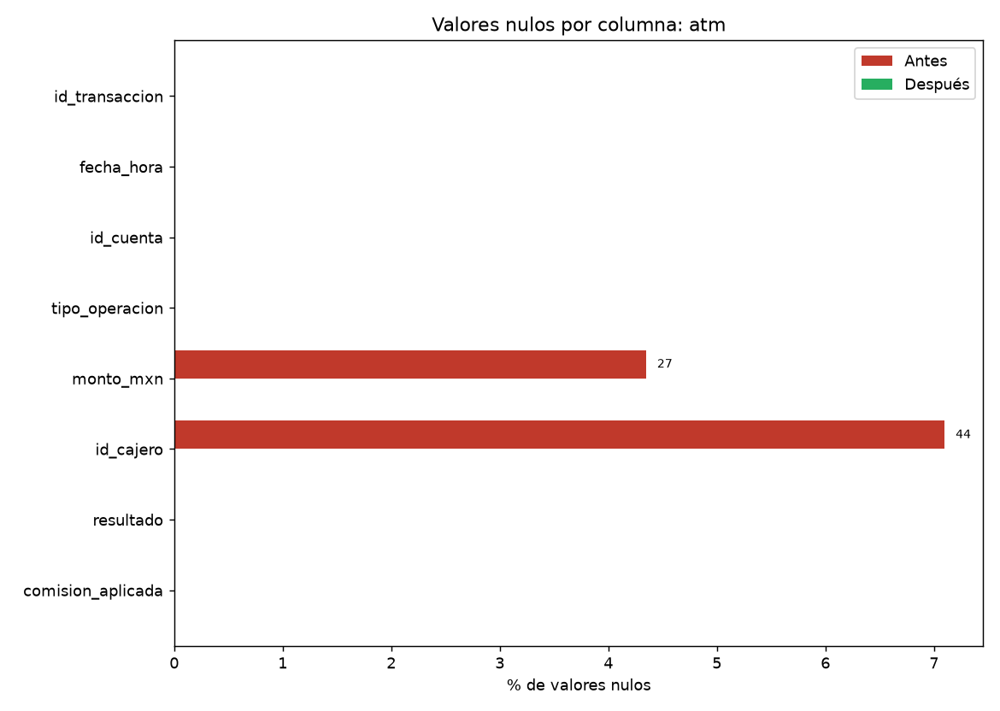
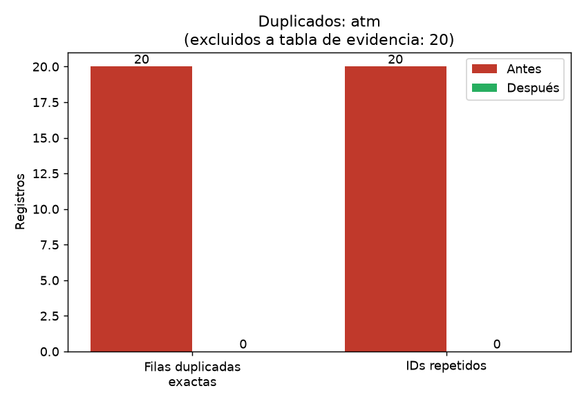
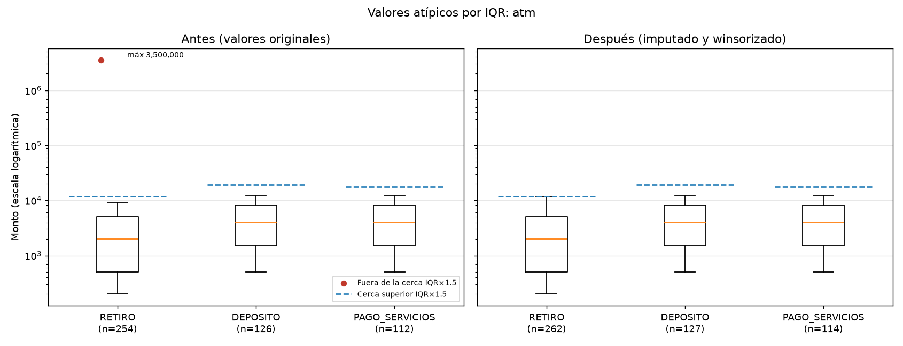

# Reporte de calidad: atm

Generado: 2026-10-23 23:44  |  Módulo: `limpieza_datos.py`

## 1. Resumen antes / después

| Métrica | Antes | Después |
| --- | --- | --- |
| Filas | 620 | 600 |
| Columnas | 8 | 17 (+9 derivadas de auditoría) |
| Celdas nulas (columnas originales) | 71 | 0 |
| Filas duplicadas exactas | 20 | 0 |
| IDs repetidos | 20 | 0 |
| Montos winsorizados | 0 | 1 |

## 2. Perfil inicial

### Columnas, tipos y nulos

| columna | dtype_pandas | tipos_python | n_nulos | pct_nulos | n_unicos | ejemplos_frecuentes |
| --- | --- | --- | --- | --- | --- | --- |
| id_transaccion | str | str:620 | 0 | 0.00 | 600 | ATM-TX-00058(2); ATM-TX-00068(2); ATM-TX-00078(2) |
| fecha_hora | str | str:620 | 0 | 0.00 | 600 | 2026/09/12 09:40:00(2); 2026/09/18 11:30:00(2); 07/10/2026 14:00(2) |
| id_cuenta | str | str:620 | 0 | 0.00 | 82 | CTA-0012(19); CTA-0011(18); CTA-0004(18) |
| tipo_operacion | str | str:620 | 0 | 0.00 | 4 | RETIRO(270); DEPOSITO(133); PAGO_SERVICIOS(116) |
| monto_mxn | float64 | float:593 | 27 | 4.35 | 14 | 0.0(101); 500.0(87); 12000.0(49) |
| id_cajero | str | str:576 | 44 | 7.10 | 5 | ATM-COL-01(126); ATM-MZL-01(124); ATM-TECO-01(113) |
| resultado | str | str:620 | 0 | 0.00 | 4 | EXITOSA(308); FALLO_CONEXION(120); FALLO_FONDOS(107) |
| comision_aplicada | float64 | float:620 | 0 | 0.00 | 4 | 0.0(171); 15.0(159); 34.8(155) |

### Inconsistencias detectadas

| columna | tipo | cantidad | detalle |
| --- | --- | --- | --- |
| resultado | MAYUSCULAS_MEZCLADAS | 85 | {'EXITOSA': 308, 'exitosa': 85} |
| fecha_hora | FORMATOS_FECHA_MEZCLADOS | 400 | d/d/d d:d:d=220; d/d/d d:d=200; d-d-d d:d:d=200 |
| id_cuenta | FUERA_DE_PATRON_ESPERADO | 32 | patrón ^CTA-00\d{2}$; ejemplos: ['CTA-8997', 'CTA-8207', 'CTA-9193'] |
| monto_mxn | MONTO_CERO | 101 | puede ser legítimo (p. ej. consulta de saldo); ver monto_estado |

## 3. Valores faltantes: ¿MCAR o MAR?

> No es posible *demostrar* el mecanismo solo con los datos observados: un p-valor alto indica ausencia de evidencia contra MCAR, no su confirmación, y MNAR (el faltante depende del propio valor ausente) no puede descartarse. Con pocos faltantes las pruebas tienen poca potencia.

**monto_mxn**: 27 nulos de 503 (5.37 %). Población evaluada sin ['CONSULTA_SALDO'] (monto $0 estructural, nunca falta).

- Lectura: SIN EVIDENCIA CONTRA MCAR con las variables disponibles (no demuestra MCAR; MNAR no puede descartarse)

| variable | prueba | p_valor | efecto(V Cramér) | pct_celdas_esp<5 |
| --- | --- | --- | --- | --- |
| id_cajero | chi-cuadrada | 0.36 | 0.10 | 25.00 |
| tipo_operacion | chi-cuadrada | 0.59 | 0.05 | 0.00 |
| resultado | chi-cuadrada | 0.65 | 0.04 | 16.70 |
| comision_aplicada | chi-cuadrada | 0.80 | 0.04 | 0.00 |
_Umbral Bonferroni: p < 0.0125_

**id_cajero**: 42 nulos de 600 (7.0 %). 

- Lectura: SIN EVIDENCIA CONTRA MCAR con las variables disponibles (no demuestra MCAR; MNAR no puede descartarse)

| variable | prueba | p_valor | efecto(V Cramér) | pct_celdas_esp<5 |
| --- | --- | --- | --- | --- |
| resultado | chi-cuadrada | 0.35 | 0.06 | 0.00 |
| tipo_operacion | chi-cuadrada | 0.41 | 0.07 | 0.00 |
| comision_aplicada | chi-cuadrada | 0.51 | 0.06 | 0.00 |
| monto_mxn | chi-cuadrada | 0.80 | 0.13 | 46.70 |
_Umbral Bonferroni: p < 0.0125_

## 4. Transformaciones aplicadas

| Regla | Celdas/filas afectadas |
| --- | --- |
| NORMALIZAR_MAYUSCULAS | 85 |
| NULO_A_ETIQUETA_CONTROLADA | 42 |
| IMPUTACION_MEDIANA | 27 |
| DUPLICADO_EXACTO_EXCLUIDO | 20 |
| WINSORIZACION_IQR | 1 |

Detalle celda a celda (valor original -> valor nuevo): `*_auditoria_cambios.csv`. Filas duplicadas retiradas: `*_duplicados_excluidos.csv`.

### Imputación

- `monto_mxn`: 27 faltantes (5.37 % de la población aplicable); imputado con mediana por segmento {"DEPOSITO": 4000.0, "PAGO_SERVICIOS": 4000.0, "RETIRO": 2000.0}
- `id_cajero`: 42 nulos -> etiqueta `CAJERO_NO_REGISTRADO`

### Estados de monto (sin modificar)

| monto_estado | n |
| --- | --- |
| POSITIVO | 476 |
| CERO_ESPERADO | 97 |
| FALTANTE | 27 |

### Formatos de fecha detectados

| Formato origen | n |
| --- | --- |
| YYYY/MM/DD HH:MM:SS (sin zona) | 211 |
| YYYY-MM-DD HH:MM:SS (sin zona) | 196 |
| DD/MM/YYYY HH:MM (sin zona) | 193 |

## 5. Valores atípicos (IQR × 1.5)

Se calcula por segmento sobre montos observados > 0. **Leve** = fuera de Q±1.5·IQR (solo se marca); **Extremo** = fuera de Q±3·IQR (se winsoriza al límite 1.5·IQR y se conserva el original).

| Segmento | n | Q1 | Q3 | Lím. inf. | Lím. sup. | Máximo | Leves altos | Extremos altos | Bajos / nota |
| --- | --- | --- | --- | --- | --- | --- | --- | --- | --- |
| RETIRO | 246 | 500.00 | 5,000.00 | -6,250.00 | 11,750.00 | 3,500,000.00 | 0 | 1 | 0 |
| DEPOSITO | 120 | 500.00 | 8,000.00 | -10,750.00 | 19,250.00 | 12,000.00 | 0 | 0 | 0 |
| PAGO_SERVICIOS | 110 | 1,500.00 | 8,000.00 | -8,250.00 | 17,750.00 | 12,000.00 | 0 | 0 | 0 |

## 6. Perfil final

| columna | dtype_pandas | tipos_python | n_nulos | pct_nulos | n_unicos | ejemplos_frecuentes |
| --- | --- | --- | --- | --- | --- | --- |
| id_transaccion | str | str:600 | 0 | 0.00 | 600 | ATM-TX-00001(1); ATM-TX-00002(1); ATM-TX-00003(1) |
| fecha_hora | str | str:600 | 0 | 0.00 | 600 | 2026/09/15 08:45:00(1); 12/09/2026 13:26(1); 2026/09/28 11:15:00(1) |
| id_cuenta | str | str:600 | 0 | 0.00 | 82 | CTA-0012(19); CTA-0004(18); CTA-0011(17) |
| tipo_operacion | str | str:600 | 0 | 0.00 | 4 | RETIRO(262); DEPOSITO(127); PAGO_SERVICIOS(114) |
| monto_mxn | float64 | float:600 | 0 | 0.00 | 14 | 0.0(97); 500.0(84); 4000.0(57) |
| id_cajero | str | str:600 | 0 | 0.00 | 6 | ATM-COL-01(121); ATM-MZL-01(121); ATM-TECO-01(110) |
| resultado | str | str:600 | 0 | 0.00 | 3 | EXITOSA(379); FALLO_CONEXION(117); FALLO_FONDOS(104) |
| comision_aplicada | float64 | float:600 | 0 | 0.00 | 4 | 0.0(164); 15.0(153); 34.8(152) |
| flag_id_repetido | bool | bool:600 | 0 | 0.00 | 1 | False(600) |
| fecha_hora_std | datetime64[us, UTC-06:00] | Timestamp:600 | 0 | 0.00 | 598 | 2026-09-06 10:59:00-06:00(2); 2026-09-23 23:41:00-06:00(2); 2026-09-15 08:45:00- |
| fecha_formato_origen | str | str:600 | 0 | 0.00 | 3 | YYYY/MM/DD HH:MM:SS (sin zona)(211); YYYY-MM-DD HH:MM:SS (sin zona)(196); DD/MM/ |
| monto_mxn_original | float64 | float:573 | 27 | 4.50 | 14 | 0.0(97); 500.0(84); 12000.0(48) |
| monto_estado | object | str:600 | 0 | 0.00 | 3 | POSITIVO(476); CERO_ESPERADO(97); FALTANTE(27) |
| monto_atipico | object | str:600 | 0 | 0.00 | 3 | NO(475); NO_EVALUADO(124); EXTREMO_ALTO(1) |
| flag_monto_imputado | bool | bool:600 | 0 | 0.00 | 2 | False(573); True(27) |
| flag_id_cajero_imputado | bool | bool:600 | 0 | 0.00 | 2 | False(558); True(42) |
| flag_monto_winsorizado | bool | bool:600 | 0 | 0.00 | 2 | False(599); True(1) |

## 7. Gráficas

## 8. Advertencias para el equipo

- Fechas sin zona horaria se asumieron en UTC-06:00 (confirmar con el equipo).
