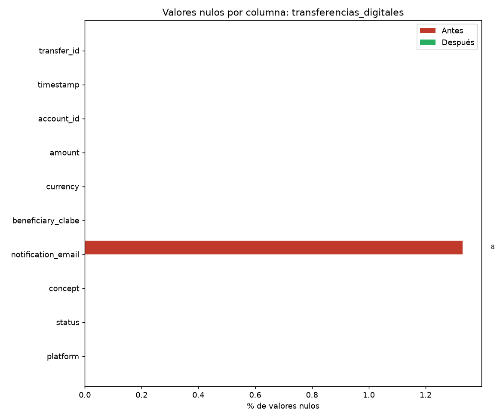
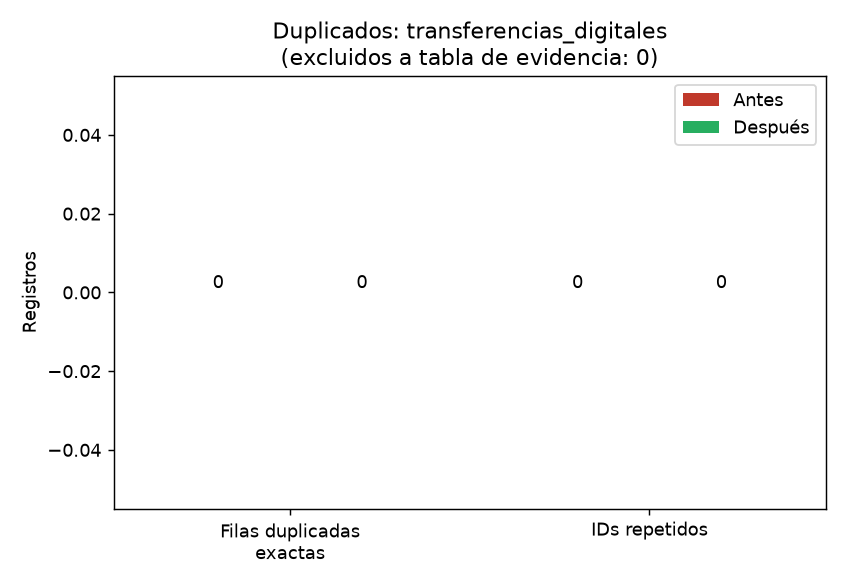
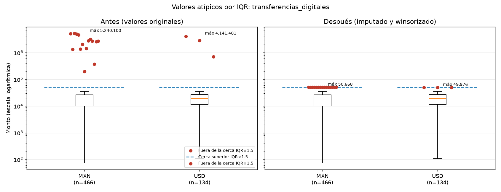

# Reporte de calidad: transferencias_digitales

Generado: 2026-10-23 23:44  |  Módulo: `limpieza_datos.py`

## 1. Resumen antes / después

| Métrica | Antes | Después |
| --- | --- | --- |
| Filas | 600 | 600 |
| Columnas | 10 | 19 (+9 derivadas de auditoría) |
| Celdas nulas (columnas originales) | 8 | 0 |
| Filas duplicadas exactas | 0 | 0 |
| IDs repetidos | 0 | 0 |
| Montos winsorizados | 0 | 18 |

## 2. Perfil inicial

### Columnas, tipos y nulos

| columna | dtype_pandas | tipos_python | n_nulos | pct_nulos | n_unicos | ejemplos_frecuentes |
| --- | --- | --- | --- | --- | --- | --- |
| transfer_id | str | str:600 | 0 | 0.00 | 600 | SPEI-2026-00001(1); SPEI-2026-00002(1); SPEI-2026-00003(1) |
| timestamp | object | str:405, int:195 | 0 | 0.00 | 598 | 2026-09-16T19:59:00-06:00(2); 2026-09-15T08:39:00-06:00(2); 2026-09-12T19:49:00- |
| account_id | str | str:600 | 0 | 0.00 | 79 | CTA-0010(16); CTA-0042(16); CTA-0040(16) |
| amount | float64 | float:600 | 0 | 0.00 | 600 | 19844.18(1); 33048.19(1); 28312.37(1) |
| currency | str | str:600 | 0 | 0.00 | 2 | MXN(466); USD(134) |
| beneficiary_clabe | str | str:600 | 0 | 0.00 | 555 | 12345(46); 012210100614023846(1); 012851851854195836(1) |
| notification_email | str | str:592 | 8 | 1.33 | 419 | correo@@sinformato(19); invalido.com(11); (8) |
| concept | str | str:600 | 0 | 0.00 | 6 | Servicios(116); Préstamo(108); Nómina(95) |
| status | str | str:600 | 0 | 0.00 | 5 | DEVUELTA(132); liquidada(121); RECHAZADA(117) |
| platform | str | str:600 | 0 | 0.00 | 4 | API Empresarial(166); Web Banking(150); App Android(145) |

### Inconsistencias detectadas

| columna | tipo | cantidad | detalle |
| --- | --- | --- | --- |
| timestamp | TIPOS_MEZCLADOS | 195 | str=405, int=195 |
| notification_email | CENTINELA_DE_NULO | 8 |  |
| status | MAYUSCULAS_MEZCLADAS | 115 | {'liquidada': 121, 'LIQUIDADA': 115} |
| timestamp | FORMATOS_FECHA_MEZCLADOS | 195 | d-d-dad:d:d-d:d=405; d=195 |
| account_id | FUERA_DE_PATRON_ESPERADO | 29 | patrón ^CTA-00\d{2}$; ejemplos: ['CTA-7940', 'CTA-7586', 'CTA-7959'] |
| beneficiary_clabe | FUERA_DE_PATRON_ESPERADO | 46 | patrón ^\d{18}$; ejemplos: ['12345'] |
| notification_email | FUERA_DE_PATRON_ESPERADO | 38 | patrón ^[\w.+-]+@[\w-]+(\.[\w-]+)+$; ejemplos: ['correo@@sinformato', 'invalido.com', ''] |

## 3. Valores faltantes: ¿MCAR o MAR?

> No es posible *demostrar* el mecanismo solo con los datos observados: un p-valor alto indica ausencia de evidencia contra MCAR, no su confirmación, y MNAR (el faltante depende del propio valor ausente) no puede descartarse. Con pocos faltantes las pruebas tienen poca potencia.

**notification_email**: 16 nulos de 600 (2.67 %). 

- Lectura: SIN EVIDENCIA CONTRA MCAR con las variables disponibles (no demuestra MCAR; MNAR no puede descartarse)

| variable | prueba | p_valor | efecto(V Cramér) | pct_celdas_esp<5 | efecto(r biserial) |
| --- | --- | --- | --- | --- | --- |
| status | chi-cuadrada | 0.14 | 0.10 | 37.50 |  |
| amount | Mann-Whitney | 0.35 |  |  | -0.14 |
| concept | chi-cuadrada | 0.53 | 0.08 | 50.00 |  |
| platform | chi-cuadrada | 0.67 | 0.05 | 50.00 |  |
| currency | chi-cuadrada | 1.00 | 0.00 | 25.00 |  |
_Umbral Bonferroni: p < 0.0100_

## 4. Transformaciones aplicadas

| Regla | Celdas/filas afectadas |
| --- | --- |
| NORMALIZAR_MAYUSCULAS | 121 |
| WINSORIZACION_IQR | 18 |
| NULO_A_ETIQUETA_CONTROLADA | 16 |
| CENTINELA_A_NULO | 8 |

Detalle celda a celda (valor original -> valor nuevo): `*_auditoria_cambios.csv`. Filas duplicadas retiradas: `*_duplicados_excluidos.csv`.

### Imputación

- `amount`: 0 faltantes (0.0 % de la población aplicable); NO imputado: sin faltantes
- `notification_email`: 16 nulos -> etiqueta `SIN_CORREO`

### Estados de monto (sin modificar)

| monto_estado | n |
| --- | --- |
| POSITIVO | 600 |

### Formatos de fecha detectados

| Formato origen | n |
| --- | --- |
| ISO8601 con offset | 405 |
| EPOCH segundos | 195 |

## 5. Valores atípicos (IQR × 1.5)

Se calcula por segmento sobre montos observados > 0. **Leve** = fuera de Q±1.5·IQR (solo se marca); **Extremo** = fuera de Q±3·IQR (se winsoriza al límite 1.5·IQR y se conserva el original).

| Segmento | n | Q1 | Q3 | Lím. inf. | Lím. sup. | Máximo | Leves altos | Extremos altos | Bajos / nota |
| --- | --- | --- | --- | --- | --- | --- | --- | --- | --- |
| MXN | 466 | 10,000.95 | 26,267.60 | -14,399.01 | 50,667.57 | 5,240,100.00 | 0 | 15 | 0 |
| USD | 134 | 11,413.89 | 26,838.64 | -11,723.23 | 49,975.76 | 4,141,401.00 | 0 | 3 | 0 |

## 6. Perfil final

| columna | dtype_pandas | tipos_python | n_nulos | pct_nulos | n_unicos | ejemplos_frecuentes |
| --- | --- | --- | --- | --- | --- | --- |
| transfer_id | str | str:600 | 0 | 0.00 | 600 | SPEI-2026-00001(1); SPEI-2026-00002(1); SPEI-2026-00003(1) |
| timestamp | object | str:405, int:195 | 0 | 0.00 | 598 | 2026-09-16T19:59:00-06:00(2); 2026-09-15T08:39:00-06:00(2); 2026-09-12T19:49:00- |
| account_id | str | str:600 | 0 | 0.00 | 79 | CTA-0010(16); CTA-0042(16); CTA-0040(16) |
| amount | float64 | float:600 | 0 | 0.00 | 584 | 50667.57(15); 49975.76(3); 19844.18(1) |
| currency | str | str:600 | 0 | 0.00 | 2 | MXN(466); USD(134) |
| beneficiary_clabe | str | str:600 | 0 | 0.00 | 555 | 12345(46); 012210100614023846(1); 012851851854195836(1) |
| notification_email | str | str:600 | 0 | 0.00 | 419 | correo@@sinformato(19); SIN_CORREO(16); invalido.com(11) |
| concept | str | str:600 | 0 | 0.00 | 6 | Servicios(116); Préstamo(108); Nómina(95) |
| status | str | str:600 | 0 | 0.00 | 4 | LIQUIDADA(236); DEVUELTA(132); RECHAZADA(117) |
| platform | str | str:600 | 0 | 0.00 | 4 | API Empresarial(166); Web Banking(150); App Android(145) |
| flag_id_repetido | bool | bool:600 | 0 | 0.00 | 1 | False(600) |
| fecha_hora_std | datetime64[us, UTC-06:00] | Timestamp:600 | 0 | 0.00 | 594 | 2026-10-14 23:04:00-06:00(2); 2026-09-16 19:59:00-06:00(2); 2026-09-15 08:39:00- |
| fecha_formato_origen | str | str:600 | 0 | 0.00 | 2 | ISO8601 con offset(405); EPOCH segundos(195) |
| amount_original | float64 | float:600 | 0 | 0.00 | 600 | 19844.18(1); 33048.19(1); 28312.37(1) |
| monto_estado | object | str:600 | 0 | 0.00 | 1 | POSITIVO(600) |
| monto_atipico | object | str:600 | 0 | 0.00 | 2 | NO(582); EXTREMO_ALTO(18) |
| flag_monto_imputado | bool | bool:600 | 0 | 0.00 | 1 | False(600) |
| flag_notification_email_imputado | bool | bool:600 | 0 | 0.00 | 2 | False(584); True(16) |
| flag_monto_winsorizado | bool | bool:600 | 0 | 0.00 | 2 | False(582); True(18) |

## 7. Gráficas

## 8. Advertencias para el equipo

- Segmento 'MXN': 15 extremos (3.2% de los registros). Una proporción así sugiere un error sistemático (escala/unidad/captura) y no ruido aleatorio: conviene enviarlos a revisión o cuarentena usando el monto original (columna *_original) en lugar de confiar en el valor recortado.
- Segmento 'USD': 3 extremos (2.2% de los registros). Una proporción así sugiere un error sistemático (escala/unidad/captura) y no ruido aleatorio: conviene enviarlos a revisión o cuarentena usando el monto original (columna *_original) en lugar de confiar en el valor recortado.
- Hay montos en varias monedas y no hay tipo de cambio: el IQR se calculó por moneda y NO se convirtieron importes. El Integrante 2 debe definir la regla antes de sumar montos entre monedas.
- Fechas sin zona horaria se asumieron en UTC-06:00 (confirmar con el equipo).
